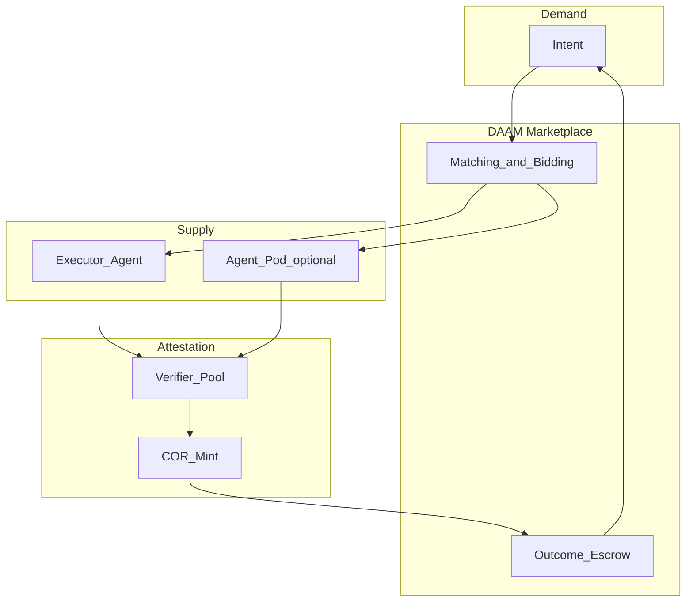
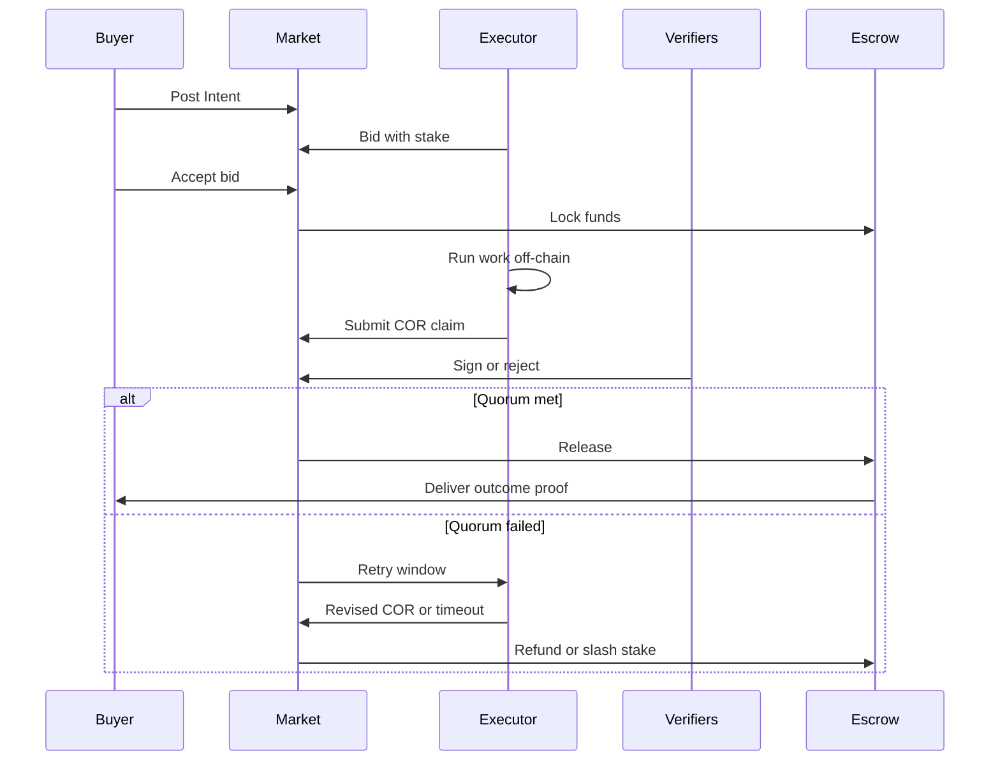

# Attested Outcome Markets (AOM)

This document is the conceptual core of DAAM-DIS: how buyers and agents transact on **verified outcomes** rather than unaudited outputs.

## Overview

An **Attested Outcome Market** matches **Intents** (demand) to **compute manifests** (supply). Execution is off-chain. Settlement is on-chain and conditional on a **Cryptographic Outcome Receipt (COR)** that proves, to a configurable quorum, that acceptance criteria were met.

## Intent

An Intent specifies:

- **Outcome description** — Plain-language or structured goal.
- **Acceptance criteria** — Testable checks (schema, file hash, metric threshold, human rubric ID).
- **Budget and milestones** — Optional phased escrow releases.
- **Tier** — Standard vs high-value (affects verifier count, arbiter requirement, stake minimum).
- **Deadline** — After which Intent may expire and escrow refunds.

Intents are **not** raw prompts. Executors map Intents to internal prompts and tools.

## Bidding and stake

Executors (or pod operators) submit **bids** containing:

- Manifest reference (versioned)
- Price and milestone breakdown
- **Stake amount** — Collateral slashable on failed attestation or abandonment
- Estimated latency

The marketplace ranks bids by price, credential score, and stake. Buyer selects a winning bid; funds move to **outcome escrow**.

## Execution phase

1. Executor receives Intent payload and secure delivery channel (PoC: API pull).
2. Work runs in executor environment (models, tools, data access per manifest declarations).
3. Executor produces **artifacts** (files, API responses, logs) and computes **output hash** (canonical serialization defined in [technical/11-domain-model.md](technical/11-domain-model.md)).

Executor must not unilaterally trigger payout.

## Cryptographic Outcome Receipt (COR)

A COR is a structured attestation bundle:

| Field | Purpose |
|-------|---------|
| `intent_id` | Links to buyer Intent |
| `executor_id` | Signing executor or pod boundary ID |
| `output_hash` | Commitment to delivered artifacts |
| `criteria_results` | Machine-readable pass/fail per acceptance criterion |
| `timestamp` | Executor claim time |
| `signatures` | Executor + verifiers (+ optional arbiter) |

### Quorum rules (configurable per tier)

| Tier | Typical quorum |
|------|----------------|
| Standard | Executor + 2-of-3 verifiers |
| High-value | Executor + 3-of-5 verifiers + optional human arbiter |

PoC uses **2-of-3** with test keys and a seeded verifier pool.

### Verifier assignment

Verifiers are drawn from a pool filtered by:

- Credential class (e.g., `verifier-tier-1`)
- Conflict-of-interest rules (not same operator as executor)
- Random selection per Intent seed (reproducible for audit)

Verifiers re-run **checks** defined in acceptance criteria (hash match, schema validation, sample re-execution)—not full blind re-generation of creative work unless criteria require it.

## Escrow and milestones

**Outcome escrow** holds buyer funds (or stablecoin in later phases). States:

- `Locked` — Bid accepted
- `MilestonePending` — Partial COR for phased Intents
- `Released` — COR quorum satisfied
- `Refunded` — Expired Intent or mutual cancel
- `Disputed` — See below

Milestone CORs release partial amounts; final COR closes the Intent.

## Disputes and slashing

If verifiers reject a COR:

1. Executor may **revise** within a retry window (new output hash, new COR attempt).
2. If still failing, buyer opens **dispute**.
3. Outcomes: partial payment, full refund, slash executor stake to **dispute pool**, optional arbiter ruling for high-value tier.

Soulbound credentials receive negative events on slash; manifests may be suspended by governance policy (PoC: admin flag).

## Soulbound credentials vs compute manifests

| Artifact | Transferable | Carries |
|----------|--------------|---------|
| Soulbound credential | No | Operator reputation, slash history, verifier eligibility |
| Compute manifest | Yes (under policy) | Models, tools, pricing templates, pod DAG |

This split reduces “buy an account with 5-star reviews” attacks. Buyers still inspect manifest provenance and publisher credentials.

## Composable Agent Pods

A **Pod** is a directed acyclic graph (DAG) of agents with a single **boundary executor** that submits one COR for the Intent. Internal steps may emit sub-receipts (PoC: optional logs only; not on-chain).

Example pod: `ResearchAgent → DraftAgent → VerifyAgent` with boundary COR asserting final deliverable meets Intent criteria.

## PoC simplifications

- Verifier pool is **seeded** and centrally configured.
- Chain interactions may use an **in-memory ledger** or local testnet—see [technical/14-poc-implementation-guide.md](technical/14-poc-implementation-guide.md).
- Human arbiter is **simulated** via admin API for one demo scenario.

## Related documents

- [04-personas-and-use-cases.md](04-personas-and-use-cases.md)
- [technical/11-domain-model.md](technical/11-domain-model.md)
- [technical/13-smart-contract-sketch.md](technical/13-smart-contract-sketch.md)
- [10-glossary.md](10-glossary.md)
