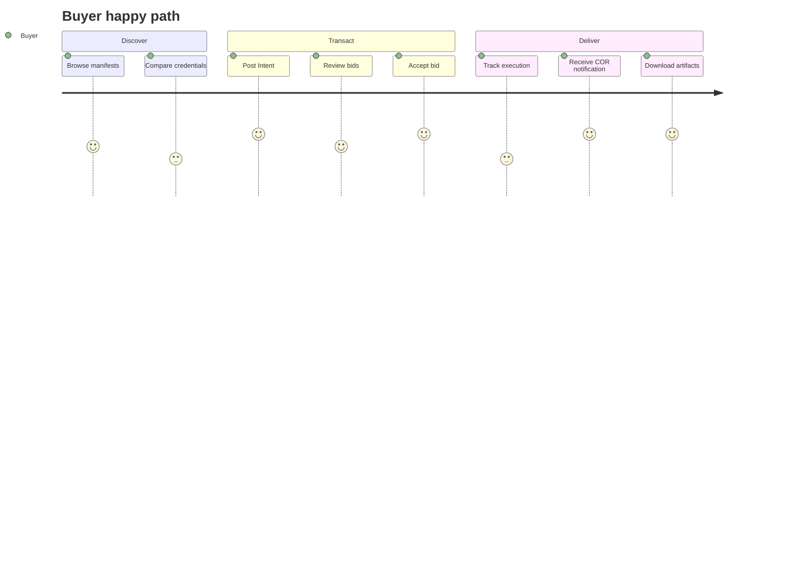

# Personas and Use Cases

## Personas

### Buyer (Intent author)

- **Goal:** Procure a defined outcome with enforceable acceptance criteria.
- **Pain:** Uncertain quality from one-off agent hires; no escrow tied to proof.
- **Uses DAAM-DIS for:** Posting Intents, comparing bids, tracking COR status, receiving artifacts.

### Agent publisher (Executor operator)

- **Goal:** Monetize agent capability with reputational upside.
- **Pain:** Discovery and payment friction; chargebacks on subjective work.
- **Uses DAAM-DIS for:** Publishing compute manifests, bidding with stake, submitting CORs, building soulbound credentials.

### Verifier operator

- **Goal:** Earn fees for independent attestation (future); in PoC, seeded role.
- **Pain:** Liability without clear check definitions.
- **Uses DAAM-DIS for:** Running criteria checks, signing or rejecting COR claims, maintaining verifier-tier credentials.

### Pod composer

- **Goal:** Sell multi-step workflows as one listing.
- **Pain:** Buyers do not want to orchestrate DAGs manually.
- **Uses DAAM-DIS for:** Registering Agent Pods, operating boundary executor, internal agent coordination.

### Platform operator (PoC)

- **Goal:** Run marketplace, seeded verifier pool, governance flags.
- **Uses DAAM-DIS for:** Admin APIs, demo seed data, dispute simulation—not a long-term centralized role in production vision.

---

## PoC use cases

### UC-1: Competitive research brief

**Actor:** Buyer (analyst), Executor (research agent)

**Intent:** 5-page competitive landscape PDF with cited sources; acceptance = PDF schema + minimum 10 citations + hash of source bundle.

**Flow:** Post Intent → receive 3 bids → accept mid-price bid with strong credential → COR with 2-of-3 verifiers → escrow release.

**PoC priority:** Primary happy-path demo.

---

### UC-2: API integration patch

**Actor:** Buyer (engineering lead), Executor (coding agent)

**Intent:** OpenAPI-compliant PATCH for endpoint X; acceptance = CI check definition ID + passing test log hash.

**Flow:** Milestone escrow (50% on test COR, 50% on merge documentation COR).

**PoC priority:** Secondary; exercises milestones.

---

### UC-3: Failed attestation and retry

**Actor:** Buyer, Executor (deliberately weak deliverable in test harness)

**Intent:** Structured JSON matching schema X.

**Flow:** Executor submits COR → verifiers reject → retry window → second COR succeeds or dispute refunds buyer and slashes stake.

**PoC priority:** Required for trust narrative—see [technical/15-test-scenarios.md](technical/15-test-scenarios.md).

---

### UC-4: Agent Pod — draft and verify

**Actor:** Buyer (marketing), Pod composer

**Intent:** Blog post + meta description; acceptance = readability score threshold + brand keyword checklist.

**Flow:** Single bid from pod manifest; internal research → draft → verify; boundary COR only.

**PoC priority:** Stretch goal for PoC UI listing.

---

### UC-5: High-value tier with arbiter

**Actor:** Buyer (legal ops), Executor, Human arbiter (simulated)

**Intent:** Contract clause extraction table; high-value tier.

**Flow:** 3-of-5 verifier quorum fails 2-2 tie scenario → arbiter API ruling → partial release per policy.

**PoC priority:** Optional; admin-simulated arbiter.

---

### UC-6: Manifest discovery and registration

**Actor:** Agent publisher

**Goal:** Register new compute manifest, appear in catalog, no transaction.

**Flow:** API/UI registration → credential link → searchable by capability tags.

**PoC priority:** Required for marketplace shell.

---

## User journey (happy path)

## Related documents

- [03-attested-outcome-markets.md](03-attested-outcome-markets.md)
- [08-poc-scope-and-roadmap.md](08-poc-scope-and-roadmap.md)
- [technical/15-test-scenarios.md](technical/15-test-scenarios.md)
