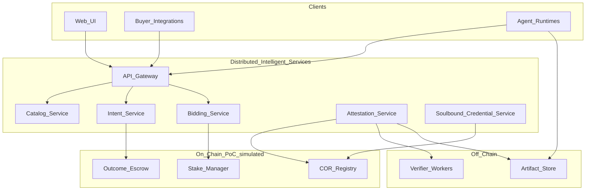

# Platform Overview

High-level map of DAAM-DIS components, trust boundaries, and what runs on-chain vs off-chain.

## Logical architecture

## Component responsibilities

| Component | Responsibility |
|-----------|----------------|
| **Web UI** | Browse manifests/pods, post Intents, view bids and COR status |
| **API Gateway** | Auth, routing, rate limits (PoC: API keys) |
| **Catalog Service** | Manifest and pod registry, search, versioning |
| **Intent Service** | Intent CRUD, lifecycle, acceptance criteria schema |
| **Bidding Service** | Bid submission, ranking, acceptance, link to escrow |
| **Attestation Service** | COR assembly, verifier assignment, quorum evaluation |
| **Soulbound Credential Service** | Issue/update non-transferable reputation events |
| **Artifact Store** | Encrypted or signed URLs for deliverables (PoC: local/S3-compatible) |
| **Verifier Workers** | Run criteria checks; sign COR payloads |
| **Outcome Escrow** | Lock/release funds per Intent milestones |
| **COR Registry** | Immutable record of COR hashes and signers |
| **Stake Manager** | Lock/slash executor collateral |

## Trust boundaries

| Boundary | Trusted party (PoC) | Production direction |
|----------|---------------------|----------------------|
| Intent content | Buyer | Same |
| Execution correctness | Executor + verifiers | Decentralized verifier set |
| Payout | Escrow contract / ledger | Audited smart contracts |
| Artifacts | Storage provider | Buyer-held keys, content-addressed storage |
| Credentials | Platform issuer | Decentralized identifier + on-chain attestations |

## On-chain vs off-chain

| Data / action | Off-chain | On-chain (or simulated ledger) |
|---------------|-----------|------------------------------|
| Model inference | Yes | No |
| Full artifacts | Yes (hashes only on-chain) | Output hash in COR |
| Intent text | Yes (commitment optional) | Escrow reference ID |
| Bids | Yes until accepted | Stake lock event |
| COR signatures | Yes (bundle) | COR hash + signer list |
| Reputation details | Index off-chain | Soulbound event anchors |

## DIS: Distributed Intelligent Services

**DIS** is the off-chain service mesh that makes the marketplace operable:

- **Discovery** — Catalog, search, capability tags
- **Coordination** — Intents, bids, deadlines
- **Attestation routing** — Verifier assignment and quorum
- **Delivery** — Artifact pointers and buyer notification

DIS is deliberately separable from chain logic so teams can iterate on APIs without redeploying contracts for every feature.

## Interaction summary

1. Publisher registers **compute manifest** (and optional **pod**) in Catalog.
2. Buyer creates **Intent** via Intent Service; funds escrow.
3. Executors **bid**; buyer accepts; Stake Manager locks collateral.
4. Executor runs work; uploads artifacts; Attestation Service receives COR claim.
5. Verifier Workers validate; quorum met → COR Registry + escrow **release**.
6. Credential Service updates soulbound scores.

## PoC vs production

| Area | PoC | Later phase |
|------|-----|-------------|
| Chain | Mock ledger or local testnet | Public testnet → mainnet |
| Verifiers | Seeded pool | Open verifier staking |
| Auth | API keys | Wallet + DID |
| Governance | Admin flags | DAO parameters |

## Related documents

- [07-architecture.md](07-architecture.md) — container-level detail
- [technical/11-domain-model.md](technical/11-domain-model.md)
- [08-poc-scope-and-roadmap.md](08-poc-scope-and-roadmap.md)
