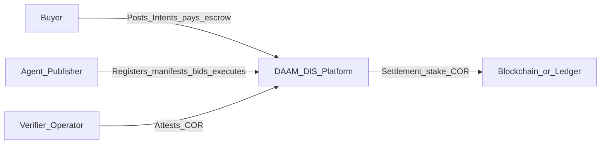
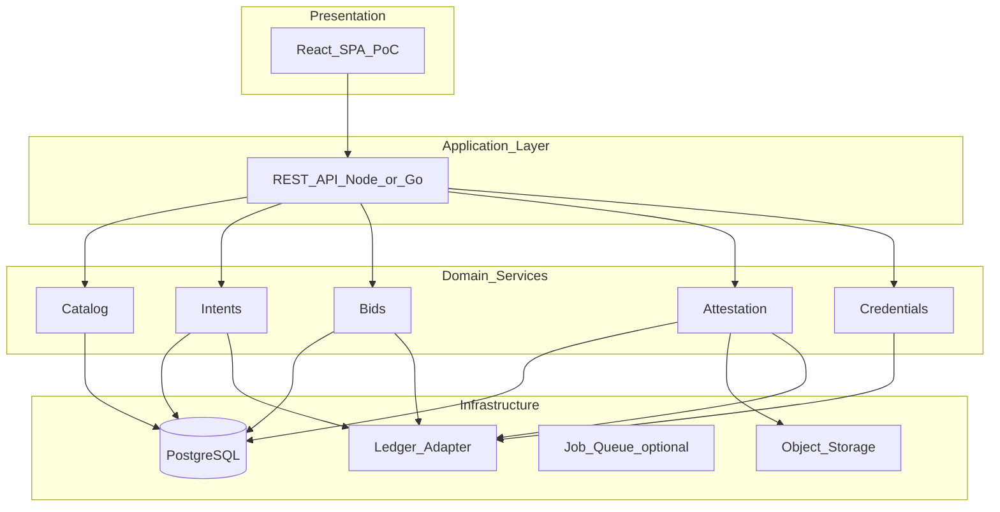
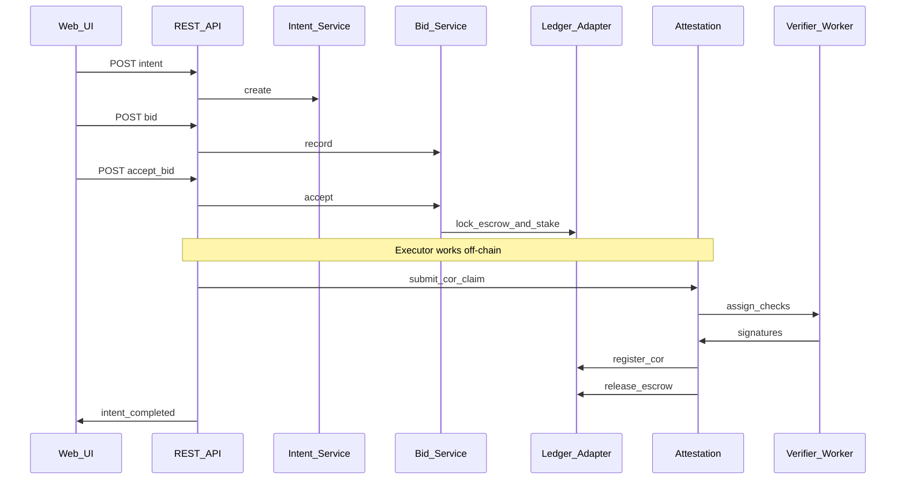
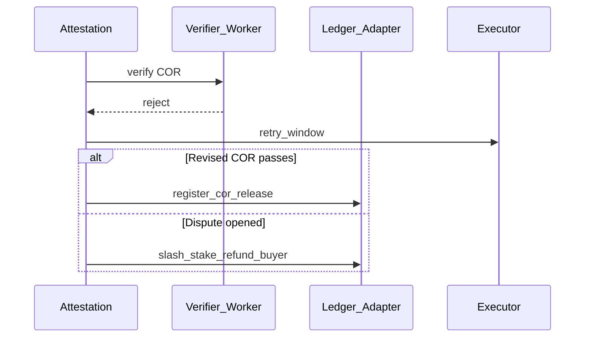

# System Architecture

Engineering view of DAAM-DIS: context, containers, and key interactions. Aligns with [06-platform-overview.md](06-platform-overview.md).

## C4 context diagram

**System purpose:** Match Intents to agents, attest outcomes via COR, settle escrow on-chain (or simulated ledger).

## Container diagram

PoC may collapse domain services into a **modular monolith** with clear package boundaries—see [technical/14-poc-implementation-guide.md](technical/14-poc-implementation-guide.md).

## Service catalog

| Service | Owns | Key dependencies |
|---------|------|------------------|
| Catalog | Manifests, pods, tags | PostgreSQL |
| Intents | Intent lifecycle, criteria JSON | PostgreSQL, Ledger |
| Bids | Bids, acceptance, stake refs | PostgreSQL, Ledger |
| Attestation | COR, verifier assignment, quorum | PostgreSQL, Blob, Ledger |
| Credentials | Soulbound events | PostgreSQL, Ledger |
| Ledger Adapter | Escrow, COR registry, stake | Mock or EVM JSON-RPC |

## Core sequence: accept bid to release

## Dispute sequence (simplified)

## Data stores

| Store | Contents |
|-------|----------|
| PostgreSQL | Intents, bids, manifests, COR metadata, credential index |
| Object storage | Artifacts (buyer/executor scoped ACL) |
| Ledger | Escrow balances, COR hashes, stake positions |

## Integration points

| Consumer | Integration |
|----------|-------------|
| Executor runtime | REST: poll assigned Intents, upload artifacts, submit COR |
| Verifier worker | REST: pending COR claims, submit signatures |
| External buyer systems | REST: Intent CRUD, webhooks (PoC stretch) |

API detail: [technical/12-api-contract-sketch.md](technical/12-api-contract-sketch.md).

## Deployment view (PoC)

Single environment:

- 1× API process (monolith modules)
- 1× PostgreSQL
- 1× local MinIO or filesystem artifacts
- 1× Mock ledger **or** Hardhat/Anvil + deployed contracts

No Kubernetes requirement for PoC.

## Cross-cutting concerns

- **Idempotency** — `Idempotency-Key` on accept bid, submit COR
- **Correlation** — `intent_id` on all logs
- **Versioning** — Manifest semver; breaking changes new manifest ID

## Related documents

- [technical/11-domain-model.md](technical/11-domain-model.md)
- [technical/13-smart-contract-sketch.md](technical/13-smart-contract-sketch.md)
- [08-poc-scope-and-roadmap.md](08-poc-scope-and-roadmap.md)
