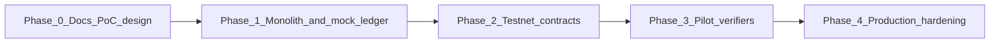

# PoC Scope and Roadmap

## Current status

**Proof of Concept** — Repository contains documentation and branch structure (`backend`, `frontend`, `codebase`, `doc`). Application code is **not yet implemented**; this document defines the PoC target state.

## PoC goals

1. Prove the **Attested Outcome Market** loop end-to-end with simulated decentralization where noted.
2. Provide a **demoable UI** and **REST API** for stakeholders and engineers.
3. Establish **schemas and contracts** for phase 2 testnet work.

## In scope

| Capability | PoC delivery | Simulated? |
|------------|--------------|------------|
| Manifest catalog (CRUD, search) | API + UI browse | No |
| Pod listing (stretch) | API + UI | No |
| Intent post and lifecycle | API + UI | No |
| Bidding and accept bid | API + UI | No |
| Outcome escrow | Ledger adapter | **Yes** (mock default) |
| Executor stake lock/slash | Ledger adapter | **Yes** |
| COR submit and quorum | Attestation + 3 seeded verifiers | **Partial** (real checks, seeded signers) |
| Artifact upload/download | Local/MinIO | No |
| Soulbound credential events | DB + optional ledger anchor | **Partial** |
| Happy-path demo script | Documented + automated | No |
| Dispute/refund path | One scenario | **Partial** (admin dispute API) |
| Human arbiter | One optional demo | **Yes** (admin API) |

## Out of scope

- Mainnet deployment
- KYC/AML and fiat on-ramps
- Open verifier recruitment and staking economics
- Cross-chain bridges
- Production-grade key management (HSM, MPC)
- Legal opinion on token/escrow classification

## Success criteria

Mapped to [technical/15-test-scenarios.md](technical/15-test-scenarios.md):

- TS-01 Happy path completes in under 5 minutes (automated).
- TS-02 Failed attestation triggers retry or refund.
- TS-03 Manifest appears in catalog after registration.
- TS-04 Escrow does not release without COR quorum.

## Phased roadmap

### Phase 0 — Documentation and design (current)

- This documentation set
- API and domain model sketches
- Demo narrative agreed with stakeholders

### Phase 1 — PoC implementation (target: 8–12 weeks indicative)

- Modular monolith API + React SPA
- Mock ledger adapter (in-memory or SQLite ledger table)
- Seeded verifiers with 2-of-3 quorum
- UC-1 research brief demo

**Exit:** TS-01 through TS-04 pass in CI or local script.

### Phase 2 — Testnet

- Deploy escrow, COR registry, stake contracts to public testnet (chain TBD)
- Wallet-based buyer/executor identities
- Replace mock ledger with contract adapter

**Exit:** Same test scenarios on testnet with test tokens.

### Phase 3 — Pilot

- 3–5 design partners
- Limited real verifier operators
- Fee model prototype

**Exit:** Paid pilot Intents with manual ops support.

### Phase 4 — Production hardening

- Security audit, monitoring, SLA
- Governance for manifest policy and slash parameters
- Compliance review per jurisdiction

## Branch strategy (repository)

| Branch | Intended work |
|--------|---------------|
| `doc` | Documentation (this set) |
| `backend` | API, services, ledger adapter |
| `frontend` | React SPA |
| `codebase` | Shared types, OpenAPI client, COR schemas |
| `video` | Demo recordings and scripts |

## Dependencies and decisions (TBD)

| Decision | Options | Impact |
|----------|---------|--------|
| Chain | Ethereum L2, other EVM, delay testnet | Phase 2 |
| Stablecoin vs native test token | PoC mock units | Demo economics |
| Auth | API keys vs wallet | UX |
| Verifier check library | JSON Schema, custom scripts | Attestation quality |

## Related documents

- [technical/14-poc-implementation-guide.md](technical/14-poc-implementation-guide.md)
- [technical/15-test-scenarios.md](technical/15-test-scenarios.md)
- [01-executive-summary.md](01-executive-summary.md)
