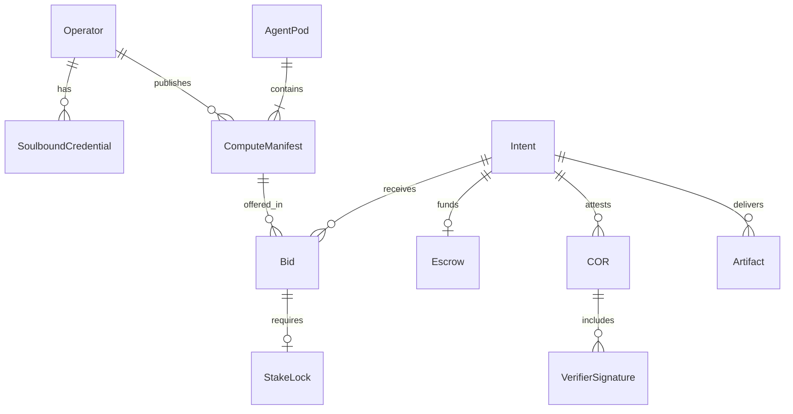
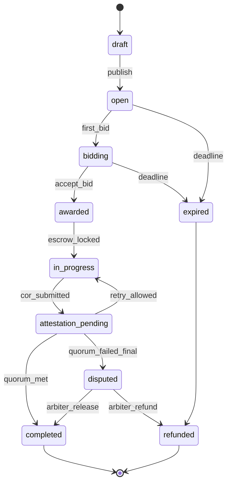
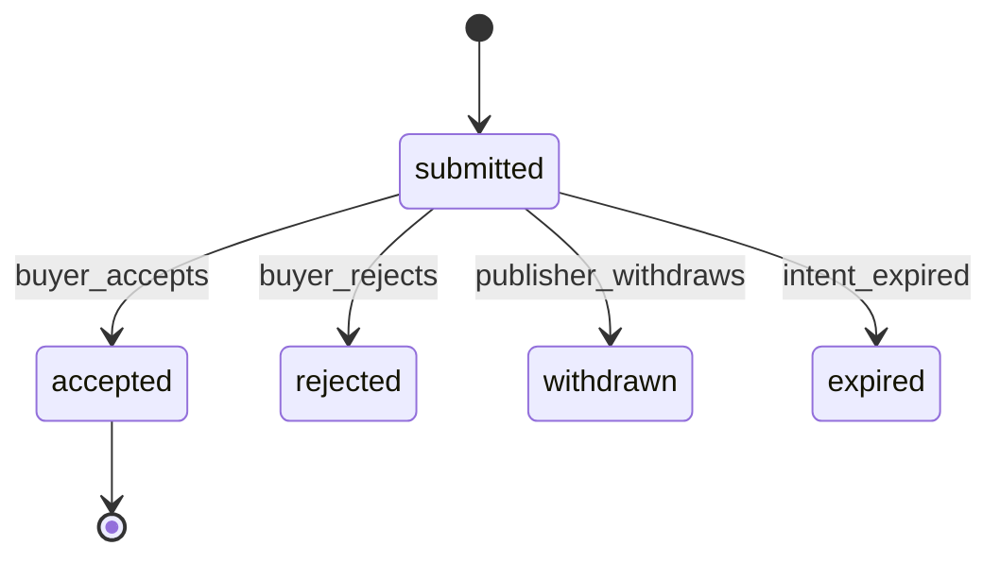
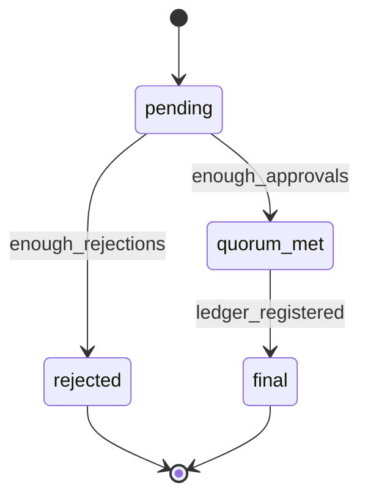

# Domain Model

Entities, relationships, and state machines for DAAM-DIS PoC. Terminology: [10-glossary.md](../10-glossary.md).

## Entity relationship (logical)



## Entities

### Operator

| Field | Type | Notes |
|-------|------|-------|
| `id` | UUID | Primary key |
| `display_name` | string | |
| `public_key` | string | PoC: ed25519 or secp256k1 hex |
| `created_at` | timestamp | |

### SoulboundCredential

| Field | Type | Notes |
|-------|------|-------|
| `id` | UUID | |
| `operator_id` | UUID | FK |
| `tier` | enum | `executor`, `verifier-tier-1`, … |
| `score` | float | 0–100 composite |
| `completed_intents` | int | |
| `slash_count` | int | |
| `ledger_anchor_tx` | string? | Optional phase 2 |

Non-transferable: no `transfer_to` operation in API.

### ComputeManifest

| Field | Type | Notes |
|-------|------|-------|
| `id` | UUID | |
| `version` | semver | |
| `operator_id` | UUID | |
| `title` | string | |
| `description` | text | |
| `capability_tags` | string[] | e.g. `research`, `code` |
| `models` | string[] | Declared models |
| `tools` | string[] | Declared tools |
| `min_stake` | decimal | |
| `pricing_template` | JSON | |
| `status` | enum | `draft`, `active`, `suspended` |

### AgentPod

| Field | Type | Notes |
|-------|------|-------|
| `id` | UUID | |
| `manifest_id` | UUID | Boundary manifest |
| `dag` | JSON | Nodes and edges |
| `boundary_executor_node` | string | DAG node ID |

### Intent

| Field | Type | Notes |
|-------|------|-------|
| `id` | UUID | |
| `buyer_id` | UUID | |
| `title` | string | |
| `outcome_description` | text | |
| `acceptance_criteria` | JSON | Array of criterion objects |
| `budget` | decimal | |
| `currency` | string | PoC: `DAAM_TEST` |
| `tier` | enum | `standard`, `high_value` |
| `deadline` | timestamp | |
| `status` | enum | See state machine |
| `escrow_id` | UUID? | |

#### Acceptance criterion object

```json
{
  "id": "crit-1",
  "type": "json_schema",
  "target": "artifact/main.json",
  "schema_ref": "https://example.com/schemas/report-v1.json"
}
```

Supported `type` values (PoC): `json_schema`, `file_hash`, `min_count`, `script_ref` (verifier runs script ID).

### Bid

| Field | Type | Notes |
|-------|------|-------|
| `id` | UUID | |
| `intent_id` | UUID | |
| `manifest_id` | UUID | |
| `operator_id` | UUID | |
| `price` | decimal | |
| `stake` | decimal | |
| `milestones` | JSON? | |
| `eta_hours` | int | |
| `status` | enum | See state machine |

### Escrow

| Field | Type | Notes |
|-------|------|-------|
| `id` | UUID | |
| `intent_id` | UUID | |
| `amount_locked` | decimal | |
| `amount_released` | decimal | |
| `status` | enum | `locked`, `partial`, `released`, `refunded`, `disputed` |

### StakeLock

| Field | Type | Notes |
|-------|------|-------|
| `id` | UUID | |
| `bid_id` | UUID | |
| `amount` | decimal | |
| `status` | enum | `locked`, `released`, `slashed` |

### COR

| Field | Type | Notes |
|-------|------|-------|
| `id` | UUID | |
| `intent_id` | UUID | |
| `executor_operator_id` | UUID | |
| `output_hash` | string | hex SHA-256 |
| `criteria_results` | JSON | |
| `status` | enum | `pending`, `quorum_met`, `rejected`, `final` |
| `cor_bundle_hash` | string | Hash of canonical signed payload |
| `ledger_tx` | string? | |

### VerifierSignature

| Field | Type | Notes |
|-------|------|-------|
| `id` | UUID | |
| `cor_id` | UUID | |
| `verifier_operator_id` | UUID | |
| `signature` | string | |
| `result` | enum | `approve`, `reject` |
| `notes` | string? | |

### Artifact

| Field | Type | Notes |
|-------|------|-------|
| `id` | UUID | |
| `intent_id` | UUID | |
| `path` | string | Storage key |
| `mime_type` | string | |
| `size_bytes` | int | |
| `hash` | string | Per-file hash |

## output_hash algorithm (PoC)

1. Build **artifact manifest** JSON: sorted list of `{ path, hash, size_bytes }`.
2. Canonicalize JSON (UTF-8, sorted keys, no whitespace).
3. `output_hash = SHA-256(canonical_manifest)`.

Executor and verifiers must use the same algorithm.

## State machines

### Intent



### Bid



### COR



## COR signing payload (canonical)

```json
{
  "cor_id": "uuid",
  "intent_id": "uuid",
  "output_hash": "hex",
  "criteria_results": [],
  "executor_operator_id": "uuid",
  "timestamp": "2026-05-25T12:00:00Z"
}
```

Sign `SHA-256(canonical_json)` with executor and verifier keys. Attestation service aggregates signatures into COR record.

## Related documents

- [12-api-contract-sketch.md](12-api-contract-sketch.md)
- [13-smart-contract-sketch.md](13-smart-contract-sketch.md)
- [03-attested-outcome-markets.md](../03-attested-outcome-markets.md)
